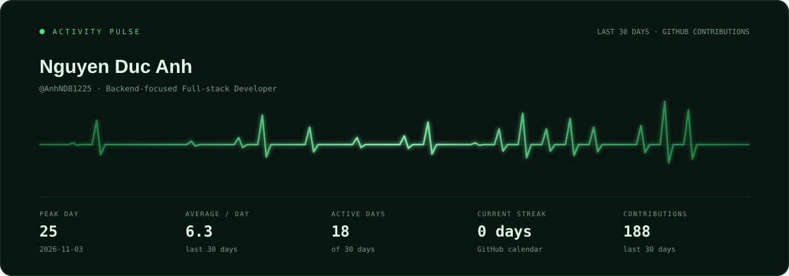
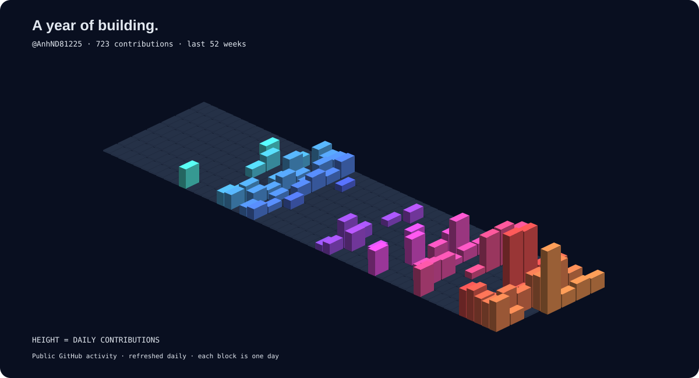

<h1 align="center">Nguyen Duc Anh</h1>

<em>Java & Spring Boot · Web & Mobile · Building useful products</em>

  

### How I work

- Backend-focused full-stack developer studying at **FPT University, Vietnam**.
- Building with **Java, Spring Boot, PostgreSQL, React, and React Native / Expo**.
- Exploring practical AI features, maintainable architecture, and API performance.

### 3D Contribution Tower

<picture>
  <source media="(prefers-color-scheme: dark)" srcset="./profile-3d-contrib/profile-night-rainbow.svg">
  <source media="(prefers-color-scheme: light)" srcset="./profile-3d-contrib/profile-season-animate.svg">
  
</picture>

Each tower represents daily GitHub contribution activity over the last year.

Language breakdown

**TypeScript** 40.4% · **JavaScript** 33.2% · **Java** 17.7% · **CSS** 6.8% · **HTML** 1.6%

More technologies

Spring Security · JWT · JPA / Hibernate · Docker · Flyway · GitHub Actions · TanStack Query · Zustand

### Projects

- <a href="https://github.com/AnhND81225/ai-study-assistant-platform">ai-study-assistant-platform</a>
- <a href="https://github.com/AnhND81225/MusicWeb_Severlet_JSP">MusicWeb_Severlet_JSP</a>
- <a href="https://github.com/AnhND81225/NguyenDucAnh-AWS">NguyenDucAnh-AWS</a>
- <a href="https://github.com/AnhND81225/technical-precision-portfolio">technical-precision-portfolio</a>

[All repositories →](https://github.com/AnhND81225?tab=repositories)

---

The pulse uses GitHub contribution counts, including commits, pull requests, reviews, and issues. One beat per day; beat height reflects activity. Updated daily · 11 Nov 2026.

Visual inspiration: [3D Contribution Tower](https://github.com/beydemirfurkan/awesome-github-profile/tree/main/templates/03-3d-immersive/3d-contribution-tower) · [Activity Pulse](https://github.com/beydemirfurkan/awesome-github-profile/tree/main/templates/05-dashboard/activity-pulse).
