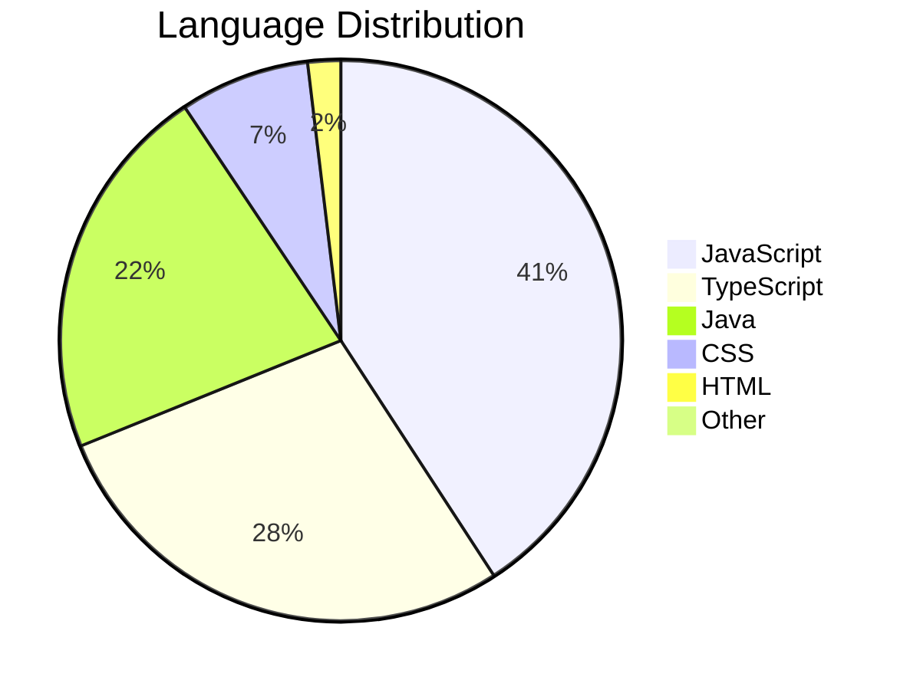
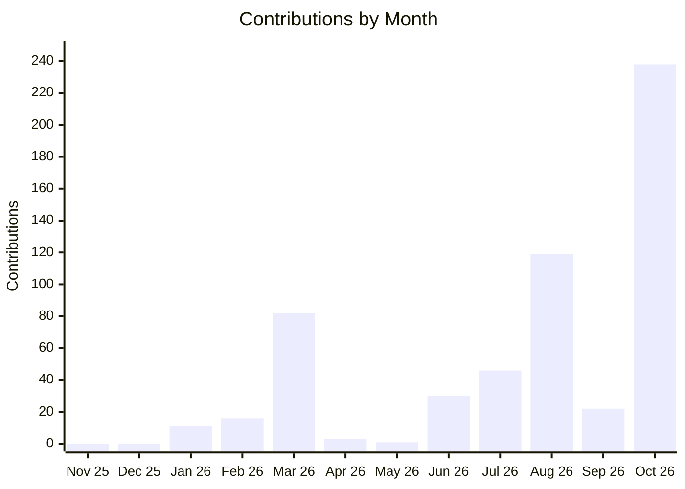
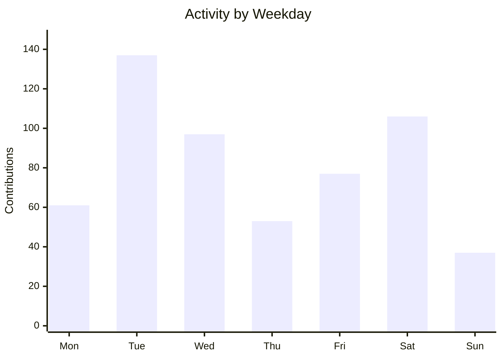

<h1 align="center">Nguyen Duc Anh</h1>

<strong>Backend-focused Full-stack Developer</strong> Building useful products with Java, Spring Boot, and React. Vietnam · FPT University

  <a href="#about">About</a> &nbsp; / &nbsp;
  <a href="#toolbox">Toolbox</a> &nbsp; / &nbsp;
  <a href="#projects">Projects</a> &nbsp; / &nbsp;
  <a href="#activity">Activity</a>

---

<table>
<tr>
<td width="25%" align="center"><h2>8</h2>PUBLIC REPOSITORIES</td>
<td width="25%" align="center"><h2>2</h2>STARS EARNED</td>
<td width="25%" align="center"><h2>568</h2>CONTRIBUTIONS / YEAR</td>
<td width="25%" align="center"><h2>6 days</h2>CURRENT STREAK</td>
</tr>
</table>

<h2 id="about">01 &nbsp; About</h2>

I work across backend, web, and mobile, with a focus on Java and Spring Boot. I enjoy turning product ideas into applications with clear APIs, secure access, and maintainable code.

<table>
<tr>
<td width="50%" valign="top"><h3>⚙️ Backend &amp; Systems</h3>
REST APIs, authentication, database design, and performance.
</td>
<td width="50%" valign="top"><h3>🧠 AI &amp; Product</h3>
Practical AI features for learning, travel, and everyday experiences.
</td>
</tr>
</table>

<h2 id="toolbox">02 &nbsp; Toolbox</h2>

| Backend | Frontend & Mobile | Data & Delivery |
| :--- | :--- | :--- |
| `Java` · `Spring Boot` | `React` · `TypeScript` | `PostgreSQL` · `Flyway` |
| `Spring Security` · `JWT` | `React Native` · `Expo` | `Docker` · `GitHub Actions` |
| `JPA / Hibernate` · `REST` | `TanStack Query` · `Zustand` | `Vercel` · `Render` |

### Language Distribution

<strong>▸ Explore language breakdown</strong>

 

| Language | Share of code |
| :--- | ---: |
| JavaScript | 40.7% |
| TypeScript | 27.9% |
| Java | 21.7% |
| CSS | 7.4% |
| HTML | 1.9% |

Based on code bytes in owned public repositories, excluding forks. This measures repository composition, rather than proficiency.

<h2 id="projects">03 &nbsp; Public Repositories</h2>

<table>
<tr><td width="50%" valign="top"><h3>↗ <a href="https://github.com/AnhND81225/ai-study-assistant-platform">ai-study-assistant-platform</a></h3>
Fullstack AI Study Assistant with Spring Boot, React PWA, PostgreSQL, Cloudinary, and OpenAI vision grading.

<code>Java</code> · ★ 2
</td><td width="50%" valign="top"><h3>↗ <a href="https://github.com/AnhND81225/MusicWeb_Severlet_JSP">MusicWeb_Severlet_JSP</a></h3>
Java web application using Servlet, JSP, Maven, and Hibernate for database CRUD operations. 

<code>Java</code> · ★ 0
</td></tr>
<tr><td width="50%" valign="top"><h3>↗ <a href="https://github.com/AnhND81225/NguyenDucAnh-AWS">NguyenDucAnh-AWS</a></h3>
AWS internship report built with Hugo

<code>JavaScript</code> · ★ 0
</td><td width="50%" valign="top"><h3>↗ <a href="https://github.com/AnhND81225/technical-precision-portfolio">technical-precision-portfolio</a></h3>
Technical Precision portfolio for Duc Anh Nguyen, Java Backend Developer.

<code>HTML</code> · ★ 0
</td></tr>
</table>

<a href="https://github.com/AnhND81225?tab=repositories">Browse all repositories ↗</a>

<strong>▸ Explore my product interests</strong>

 

| Project | Focus |
| :--- | :--- |
| 🧭 **travAIy** | Trip planning, itineraries, budgets, and group coordination. |
| 📚 **AI Study Assistant** | Learning from images, step-by-step explanations, and study history. |
| 🎓 **AIVES** | Oral exam management, rubrics, and lecturer workflows. |
| 👕 **FitMe AI** | Virtual try-on and AI-assisted outfit previews. |

<h2 id="activity">04 &nbsp; Activity</h2>

<table>
<tr>
<td width="33%" align="center"><h3>⚡ 73</h3>ACTIVE DAYS / YEAR</td>
<td width="33%" align="center"><h3>📅 Tue</h3>TOP CONTRIBUTION DAY</td>
<td width="33%" align="center"><h3>🏆 51</h3>BEST DAY / CONTRIBUTIONS</td>
</tr>
</table>

### Contribution Trend

The last 12 calendar months. The current month may be incomplete.

### Weekly Rhythm

Total contributions per weekday over the last year.

<strong>▸ View chart data</strong>

#### Contributions by month

| Month | Contributions |
| :--- | ---: |
| Nov 25 | 0 |
| Dec 25 | 0 |
| Jan 26 | 11 |
| Feb 26 | 16 |
| Mar 26 | 82 |
| Apr 26 | 3 |
| May 26 | 1 |
| Jun 26 | 30 |
| Jul 26 | 46 |
| Aug 26 | 119 |
| Sep 26 | 22 |
| Oct 26 | 238 |

#### Contributions by weekday

| Day | Contributions |
| :--- | ---: |
| Mon | 61 |
| Tue | 137 |
| Wed | 97 |
| Thu | 53 |
| Fri | 77 |
| Sat | 106 |
| Sun | 37 |

<strong>▸ View activity details</strong>

- **568 contributions** over the last year.
- **137 contributions** on Tue across the year.
- **1 full years** since the account was created.
- Streak uses GitHub's contribution calendar and allows today to be unfinished.

[View GitHub activity →](https://github.com/AnhND81225?tab=overview)

---

<a href="https://github.com/AnhND81225?tab=repositories">Explore my work ↗</a> Public GitHub data · Updated 31 Oct 2026 · 08:56 UTC

